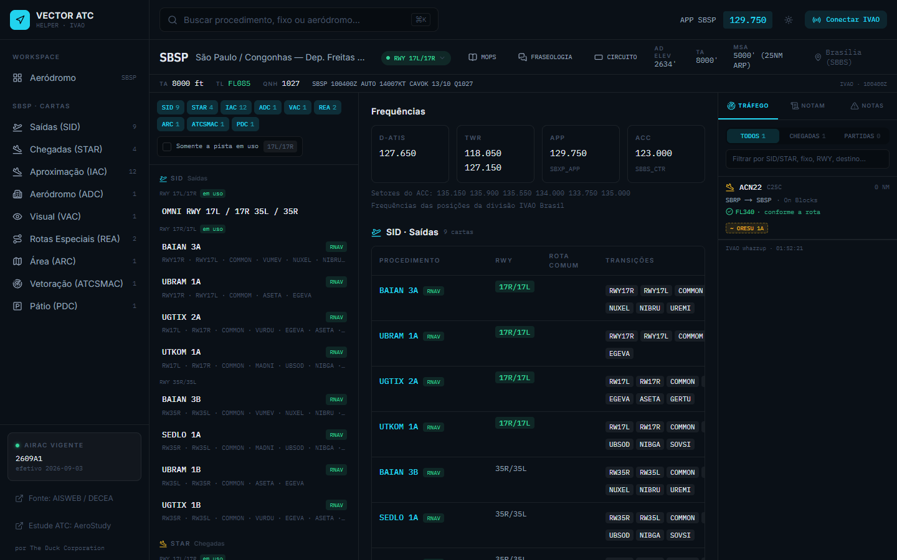
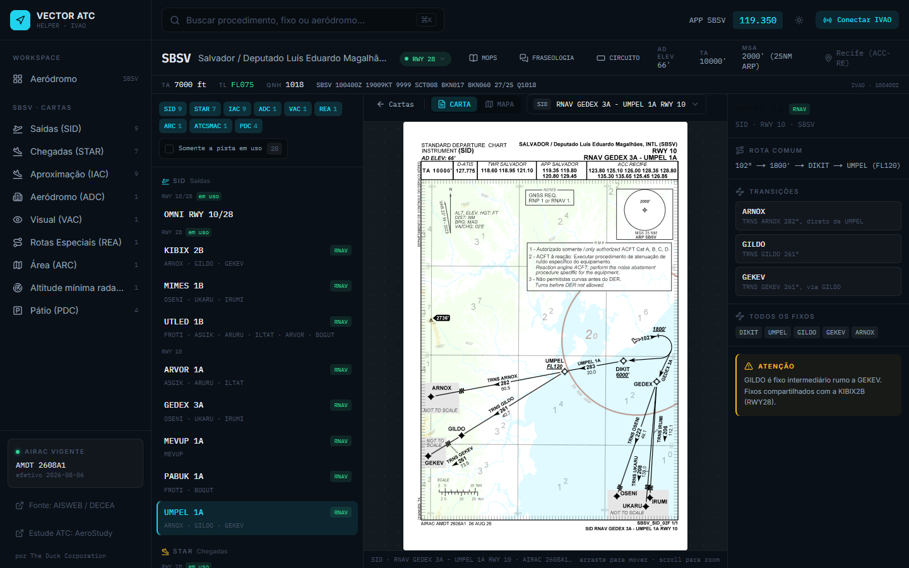
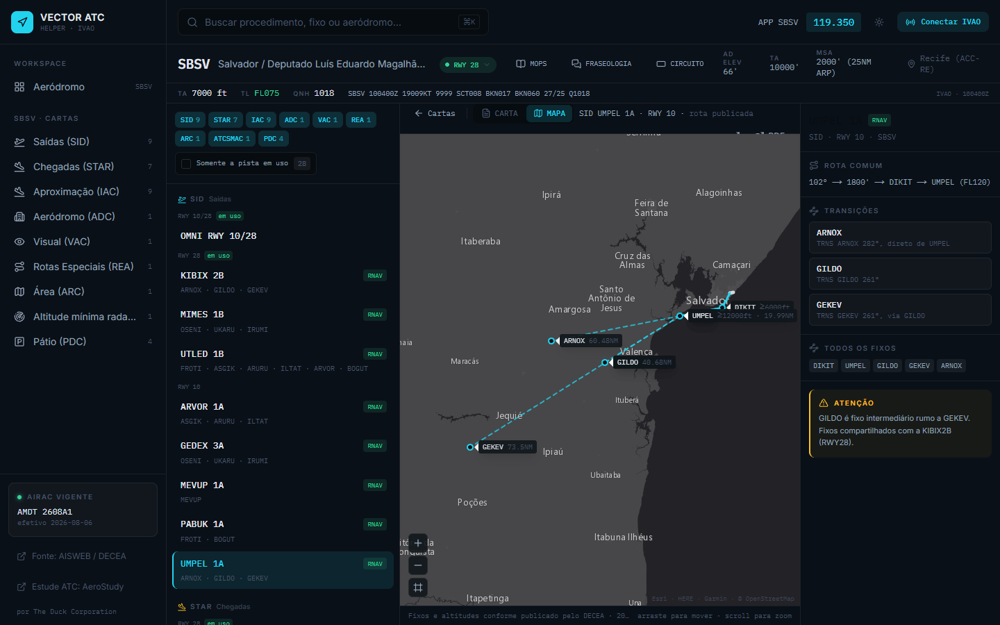

<p align="center">
  
</p>

<h1 align="center">Vector ATC</h1>

Console operacional para controladores da rede [IVAO](https://ivao.aero) no
Brasil. Reúne em uma tela as cartas oficiais do DECEA, os procedimentos SID e
STAR desenhados no mapa, a pista em uso, METAR, nível de transição, NOTAM e o
tráfego ao vivo da rede ligado ao plano de voo de cada aeronave.

**Produção:** [vectoratc.vercel.app](https://vectoratc.vercel.app)

> Material de apoio para simulação. **Não use para navegação real.**

*English: Vector ATC is an operations console for IVAO air traffic controllers
in Brazil. It shows official DECEA charts, SID/STAR procedures on a map, the
runway in use, weather, transition level, NOTAMs and live network traffic
matched to each flight plan. The interface and documentation are in
Portuguese.*



---

## O que faz

- **Cartas oficiais** do AISWEB/DECEA abertas no navegador: SID, STAR, IAC,
  ADC, VAC e PDC de cada aeródromo, mais as cartas da TMA (ARC, ATCSMAC de
  vetoração e REA de rotas especiais), com zoom, rotação e tela cheia.
- **Procedimentos no mapa**, a partir das *coding tables* do DECEA: fixos,
  transições, restrições de altitude e distância.
- **Pista em uso** detectada pelo ATIS do controlador online ou pelo vento do
  METAR, sempre com escolha manual.
- **Altimetria**: TA do aeródromo, QNH e nível de transição calculado pela
  Tabela 7 da ICA 100-37.
- **NOTAM** do DECEA e da divisão IVAO, separados.
- **Tráfego IVAO ao vivo**: chegadas e partidas, procedimento associado ao
  plano de voo (confirmado ou inferido) e verificação do nível de cruzeiro.
  A rota filada é lida trecho a trecho contra a tabela de aerovias do AIP
  (ENR 3), que diz se cada sentido usa nível ímpar ou par. Pernas diretas usam
  o rumo magnético real entre os fixos, e os planos regulares da CGNA (RPL)
  servem de referência. Também confere RVSM.
- **Login IVAO**: detecta a posição ATC do usuário e filtra as categorias de
  carta por posição (TWR, APP, GND...).
- **Referência rápida**: fraseologia padrão por fase do voo (PT-BR e EN-US),
  circuito de tráfego e link para o MOPS da TMA.
- Funciona em celular, tablet e desktop, com tema claro e escuro.

<table>
  <tr>
    <td></td>
    <td></td>
  </tr>
  <tr>
    <td align="center">Carta oficial no visualizador</td>
    <td align="center">O mesmo procedimento no mapa</td>
  </tr>
</table>

### Aeródromos

| ICAO | Aeródromo |
|---|---|
| SBBH | Belo Horizonte / Pampulha |
| SBBR | Brasília / Presidente Juscelino Kubitschek |
| SBCF | Belo Horizonte / Confins |
| SBFL | Florianópolis / Hercílio Luz |
| SBGO | Goiânia / Santa Genoveva |
| SBNT | Natal / Augusto Severo (militar) |
| SBRF | Recife / Guararapes |
| SBRJ | Rio de Janeiro / Santos Dumont |
| SBSG | Natal / São Gonçalo do Amarante |
| SBSP | São Paulo / Congonhas |
| SBSV | Salvador / Luís Eduardo Magalhães |

Quer outro? Veja [Adicionando um aeródromo](docs/adicionando-aerodromos.md) ou
abra uma *issue*.

---

## Rodando localmente

Requer **Node.js 20.9 ou mais recente**.

```bash
git clone https://github.com/sluucke/vector-atc.git
cd vector-atc
npm install
cp .env.example .env.local
npm run dev
```

Abra [http://localhost:3000](http://localhost:3000).

As cartas e os dados dos aeródromos já estão no repositório, então a aplicação
funciona sem nenhuma variável de ambiente. As variáveis só ligam recursos
opcionais:

| Variável | Para quê |
|---|---|
| `IVAO_CLIENT_ID`, `IVAO_CLIENT_SECRET`, `IVAO_REDIRECT_URL` | Login com a conta IVAO (OAuth). Crie um app em [developers.ivao.aero](https://developers.ivao.aero). Em desenvolvimento, o redirect é `http://localhost:3000/api/ivao/callback`. |
| `IVAO_API_KEY` | NOTAM e METAR da divisão IVAO. O tráfego ao vivo funciona sem ela. |
| `AISWEB_API_KEY`, `AISWEB_API_PASS` | Seu próprio par da API do AISWEB. Sem elas é usado o par público do site do AISWEB. |

### Comandos

| Comando | O que faz |
|---|---|
| `npm run dev` | Servidor de desenvolvimento |
| `npm run build` | Build de produção |
| `npm run lint` | ESLint |
| `npm run typecheck` | Checagem de tipos do TypeScript |
| `npm test` | Casos da verificação de nível de cruzeiro |
| `npm run sync:airport -- <ICAO>` | Baixa cartas e *coding tables* de um aeródromo |
| `npm run build:content -- <ICAO>` | Gera procedimentos e o esqueleto do `meta.json` |
| `npm run sync:tma` | Baixa as cartas da TMA (ARC, ATCSMAC, REA) |
| `npm run sync:frequencies` | Aplica as frequências das posições IVAO |
| `npm run sync:airways` | Lê aerovias e fixos do AIP (ENR 3 e ENR 4.4) |
| `npm run sync:rpl` | Baixa os planos de voo regulares da CGNA |
| `npm run check:airways` | Confere o AIP lido contra os planos da CGNA |
| `npm run georef:charts` | Posiciona no mapa as cartas desenhadas em escala |

---

## Como funciona

Os dados estáticos (cartas, geometria, procedimentos, frequências, aerovias do
AIP e planos regulares da CGNA) são gerados por scripts a partir do AISWEB e
da CGNA e versionados em `content/` e `public/charts/`. A aplicação é Next.js e gera uma página estática por
aeródromo, carta e procedimento. Os dados que mudam durante uma sessão (METAR,
NOTAM, pista em uso, tráfego) vêm de rotas de API consultadas pelo navegador.

Detalhes em [docs/arquitetura.md](docs/arquitetura.md).

### Stack

[Next.js 16](https://nextjs.org) (App Router) · React 19 · TypeScript ·
Tailwind CSS 4 · [pdf.js](https://mozilla.github.io/pdf.js/) ·
[Leaflet](https://leafletjs.com) · Vercel.

---

## Contribuindo

Contribuições são bem-vindas: novos aeródromos, correções de dados, melhorias
de interface. Leia o [guia de contribuição](CONTRIBUTING.md) antes de abrir um
*pull request*.

Encontrou uma falha de segurança? Siga a [política de segurança](SECURITY.md).

## Licença e dados

O código está sob a [licença MIT](LICENSE).

As cartas aeronáuticas em `public/charts/` e as informações derivadas delas em
`content/` são publicações do **DECEA** (Departamento de Controle do Espaço
Aéreo), obtidas no [AISWEB](https://aisweb.decea.mil.br). Os planos de voo
regulares em `content/rpl.json` vêm do
[CGNA](https://portal.cgna.decea.mil.br). Elas não são cobertas
pela licença MIT e pertencem ao DECEA. Este projeto não é afiliado ao DECEA nem
à IVAO.

Desenvolvido por **The Duck Corporation**.
